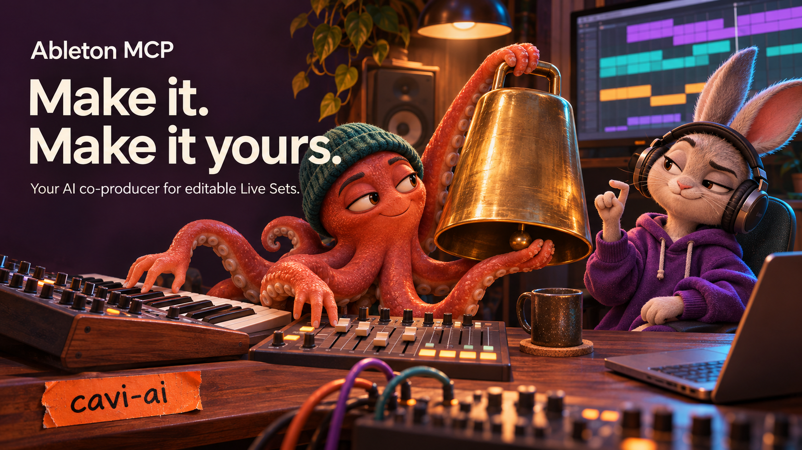

# Ableton MCP

[](https://www.npmjs.com/package/@cavi-ai/ableton-mcp) [](https://www.npmjs.com/package/@cavi-ai/ableton-mcp) [](LICENSE)



Work with an AI assistant on the music in your Ableton Live Set. Start from a brief or bring a track you’re already making. Develop the parts, change the sound, reshape the arrangement and keep refining it together.

Notes, clips, instruments and mix controls stay editable in Live.

- **Write something new.** Build related chord, bass, melody and drum MIDI parts.
- **Work with what’s there.** Inspect existing clips, add supporting parts and refine the music.
- **Take it further.** Compare sounds, shape sections and adjust the mix in the same Set.

## Try it with your next idea

> Build a four-bar chord and bass idea at this Set’s current tempo and key. Put the parts on separate MIDI tracks, keep my existing clips, and play the new idea for me.

> Keep the chords. Make the bass less busy, try a different sound and help me build an eight-bar B section. Keep the original version.

## Install

Requirements: macOS, Ableton Live 12 (tested with 12.4.6), Node.js 22.13 or newer, and `ffmpeg` for the audio analysis tools.

```bash
npm install -g @cavi-ai/ableton-mcp
ableton-mcp install
```

In Live's preferences, select **CaviMcpBridge** as a Control Surface. Then check the connection:

```bash
ableton-mcp doctor --json
```

To update, run the same `npm install -g` command, then `ableton-mcp install`, and restart Live so the bridge matches the server.

To run from a source checkout instead, clone the repository, run `npm ci`, and use `npm run cli --` in place of `ableton-mcp`.

## Connect your assistant

Register the stdio server with your MCP client:

```json
{
  "mcpServers": {
    "ableton": {
      "command": "ableton-mcp",
      "args": ["serve"]
    }
  }
}
```

If your client does not inherit your shell's `PATH`, use the absolute path printed by `which ableton-mcp`. Open a Set in Live, then ask your assistant to inspect it and help with your next idea.

## Keep making music together

Use [production sessions and specialists](docs/ableton-mcp/source/pages/guides/production-specialists.md) to keep your brief and feedback with the project as it develops. Creative and functional specialists help plan the next pass; you review the changes before they run in Live.

Explore a [musical sketch](docs/ableton-mcp/source/pages/guides/musical-sketch.md), [supporting parts](docs/ableton-mcp/source/pages/guides/supporting-parts.md), [instrument refinement](docs/ableton-mcp/source/pages/guides/instrument-refinement.md) and [Session-to-Arrangement workflow](docs/ableton-mcp/source/pages/guides/session-arrangement.md). For sound and project handoff, see [native saving and recall](docs/ableton-mcp/source/pages/guides/native-saving-and-recall.md) and [project handoff](docs/ableton-mcp/source/pages/guides/project-handoff.md).

## Documentation and help

- [Overview](docs/ableton-mcp/source/pages/introduction/overview.md), [installation](docs/ableton-mcp/source/pages/introduction/installation.md) and [quickstart](docs/ableton-mcp/source/pages/introduction/quickstart.md)
- [NKS preset catalog](docs/ableton-mcp/source/pages/guides/preset-catalog.md) and [artwork](docs/ableton-mcp/source/pages/guides/artwork.md)
- [Tools](docs/ableton-mcp/source/pages/reference/tools.md), [CLI](docs/ableton-mcp/source/pages/reference/cli.md) and [configuration](docs/ableton-mcp/source/pages/reference/configuration.md)
- [Guarded mutations](docs/ableton-mcp/source/pages/guides/guarded-mutations.md), [security model](docs/ableton-mcp/source/pages/security/model.md) and [security reporting](SECURITY.md)
- [Troubleshooting](docs/ableton-mcp/source/pages/guides/troubleshooting.md), [contributing](CONTRIBUTING.md), [changelog](CHANGELOG.md) and [releases](https://github.com/cavi-ai/ableton-mcp/releases)

## License

MIT. See [LICENSE](LICENSE).
